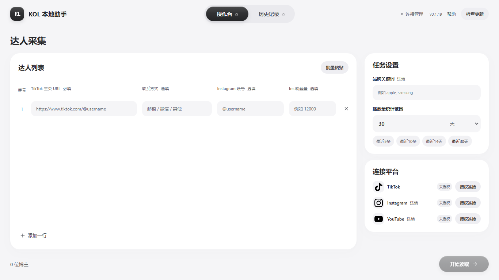
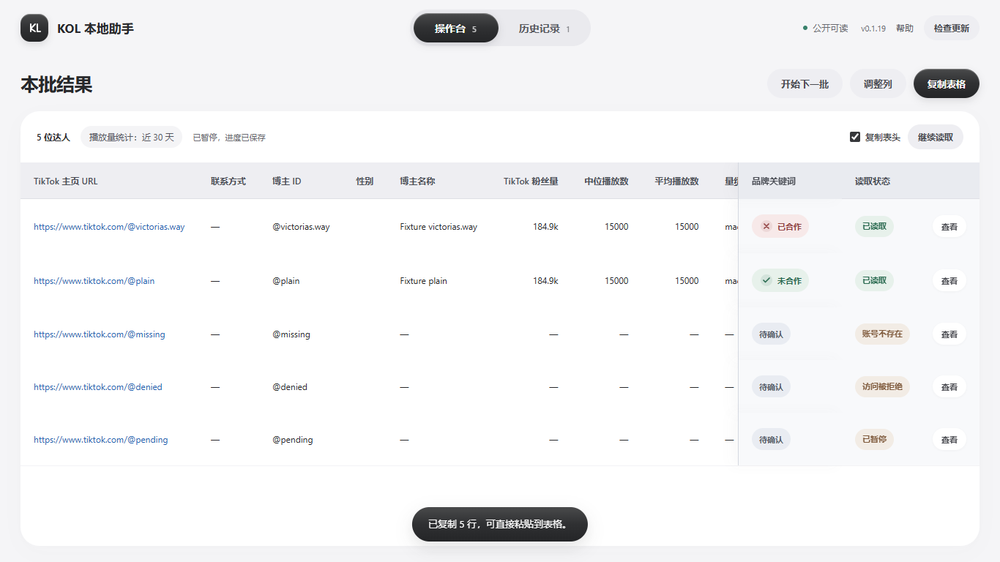

# KOL 本地助手

一个运行在 Chrome 中的达人资料整理工具。输入 TikTok 达人主页后，可以按批次读取公开资料、统计作品播放量、检索品牌关键词，并将结果复制到 Excel 或在线表格。Instagram 粉丝量和 YouTube 订阅数可按需补充。

> 当前版本为 **0.1.19 测试版**。读取受平台登录状态、授权、页面变化和访问限制影响，请根据实际状态核对结果。

## 界面展示





截图取自隔离浏览器中的 0.1.19 测试，结果页使用模拟数据，账号和数值仅用于展示。

## 解决什么问题

整理达人名单时，需要逐个查看主页、记录粉丝量、统计播放量并整理进表格。KOL 本地助手将录入、读取、检查和表格复制放在同一个工作台，帮助运营人员按批次整理资料，并查看读取状态与统计依据。

## 主要功能

- **单条与批量录入**。逐行填写 TikTok 主页与联系方式，也可批量粘贴主页链接。Instagram 信息可选填。
- **播放量统计**。按最近作品条数或天数设置范围，查看平均数、中位数和样本依据。
- **品牌关键词检索**。填写品牌词后检索近 180 天的相关作品，在详情中查看命中链接与读取状态。
- **跨平台补充**。按需连接 Instagram 和 YouTube，补充粉丝量或订阅数。YouTube 使用明确关联的频道信息。
- **结果整理**。调整输出列的显示与顺序，复制到 Excel 或在线表格，并在详情中检查和修改资料。
- **批次与历史**。保存本地批次快照，查看历史结果，或使用历史输入开启新的读取批次。
- **状态与恢复**。读取中可暂停，遇到登录、验证或访问异常时显示状态，方便处理后继续。

## 安装与使用

1. 在 [Releases](https://github.com/chenjj2578459615-stack/kol-local-assistant/releases) 下载 `KOL-plugin-0.1.19.zip`，解压完整压缩包。
2. 双击其中的 `安装或更新.cmd`，按提示准备固定插件目录。
3. 在常用 Chrome 中打开 `chrome://extensions`，开启开发者模式，点击「加载已解压的扩展程序」，选择安装程序提示的 `extension` 文件夹。
4. 将插件固定到 Chrome 工具栏，打开工作台后按需授权 TikTok、Instagram 和 YouTube。
5. 输入达人主页与关键词，设置统计范围，点击「开始读取」。查看结果后可调整输出列并复制表格。

安装工具面向 Windows，Chrome 需要 120 或更高版本。登录与验证码在平台官方页面完成，数据保存在当前 Chrome 用户的本地扩展存储中。

### 更新

解压新版安装包并运行「安装或更新」，再回到工作台点击「应用更新」。采集中请先暂停。请保留原插件和固定目录，避免因卸载插件影响已保存的本地数据。

## 界面设计与布局

界面沿用石墨白轻拟物设计。浅灰白页面和白色卡片区分内容区域，石墨光泽按钮突出主要操作。顶部模块切换居中，达人列表与任务设置分栏排列，操作入口和状态反馈保持清晰。结果表将达人资料与读取状态集中展示，支持表格滚动和查看详情。

## 版本与验证

- 当前源码与安装包版本为 0.1.19，属于独立 Chrome 插件测试版。
- 现有 41 项单元测试通过，隔离 Chrome 界面测试通过。界面测试使用模拟平台数据，覆盖多种窗口尺寸、结果表、历史记录与复制行为。
- 真实平台的读取结果会随平台变化、账号状态和网络环境变化。上述测试未覆盖所有真实平台场景。

## 项目结构

```text
extension/    Chrome 扩展源码
screenshots/  工作台和模拟结果截图
```

开发者可以在 Chrome 扩展管理页直接加载仓库中的 `extension` 目录进行开发。正式使用建议使用 Release 安装包，以固定目录和更新流程管理版本。项目尚未指定开源许可证，使用与再分发权限请联系仓库所有者。

