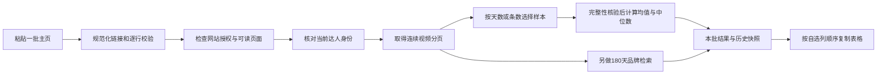

# KOL工具机制与问题复盘

更新：2026-11-23，针对0.1.13。本文从产品经理视角说明当前机制、已确认的问题、修复方式及尚未消除的限制。

## 1. 先解释这次“数据不对”

**用户后续确认：本工具统计正确，先前差异是EasyKOL尚未加载完整。截图中的平均播放量可以直接比较；当时EasyKOL只纳入32条，本工具近30天纳入33条。** 以下计算保留为当次32/33条样本差异的验证证据，不把竞品尚未完成加载推断为其固定统计口径。

不能只比较平均数，必须一起比较四件事：指标名称、视频ID集合、统计起止时间、读取时点。当前播放量是累计数，会随时间增长；同一组视频在上午和下午读取，结果也可能变化。

### 用同一份实时数据计算两种范围

2026-11-23北京时间15:58左右，独立匿名普通Chrome读取，按原始播放数计算：

| 账号 | 最近32条平均播放 | 近30天平均播放 | 近30天样本 | 多纳入的视频 |
| --- | ---: | ---: | ---: | --- |
| herodw | 869300 | 1018715 | 33条 | 5800000播放，ID 7700343290754845965 |
| mattyfc__ | 689909 | 672824 | 33条 | 126100播放，ID 7700357489291726094 |

- `herodw` 的32条均值869300正好对应EasyKOL截图869.3K。多出的580万播放视频把33条的均值拉高。
- `mattyfc__` 的32条均值689909接近截图689.8K；多出的12.61万播放视频把33条的均值拉低。该条作品在当次近30天范围内，不能为了对齐另一个口径而删除。
- 本工具用户截图显示 `herodw` 均值1018582、`mattyfc__` 均值672673；与稍后读取的近30天值很接近。现有证据支持样本范围和播放增长这两个解释，没有证据表明均值公式把点赞数当成播放数。
- EasyKOL截图第三张是中位**点赞**数6.4K，第二张为77.6K。本工具本次显示的106900、335300是中位**播放**数。该区别只适用于中位数指标，不妨碍两边平均播放量直接比较。原12个导出字段保持。

原始45条/账号数据、实际ID差集、发布时间、来源及两种计算结果见 `../artifacts/revision-0.1.13/statistics-live-results.json`。截图没有全部32条视频ID与精确原始播放数，不能声称已逐条复原竞品当时的全部输入。

### 完整程序再验证

北京时间16:09，使用0.1.13完整工作台开始任务、连接检查及后台接口，在独立匿名普通Chrome连续读取这两位达人，设置为最近32条：

| 账号 | 实际样本 | 播放总数 | 均值 | 中位播放 |
| --- | ---: | ---: | ---: | ---: |
| herodw | 32 | 27818800 | 869338 | 100800 |
| mattyfc__ | 32 | 22078300 | 689947 | 337400 |

两位合计约5.0秒，零新增标签页；不含初始浏览器和平台页准备时间。比前一组数据略有增长，说明历史结果应保持当时快照，不能随着新读数静默改写。这是当前匿名环境的成功，不能保证用户登录环境、所有账号、所有时间段都同样成功。证据：`statistics-product-live.json`。

### 本次产品修改

- 范围预设严格按用户补图：最近5条、最近10条、最近14天、最近30天。
- 自定义可选“按天数”或“按视频条数”，输入N；默认仍为近30天。需要与EasyKOL这两张截图对照时，手动选择自定义32条。
- 最近N条按发布时间选取，不按页面显示顺序。旧置顶不会因为在顶部就占用最新样本；零播放是有效数值，缺失播放不会用更旧视频偷偷补足。
- TikTok列表含视频及图文作品，当前两种范围均纳入；不能声称已与竞品未公开的所有排除规则完全一致。
- 行内直接显示口径与实际样本数，详情可查看逐视频统计依据。公开视频不足N条时，显示实际数量及不足提示；不能伪装成已得到N条。
- 有品牌词时，播放按所选范围统计，品牌仍查近180天不限条数；两者独立完成，品牌历史不会混入最近5条或近30天均值。

## 2. 这个程序究竟在做什么

**它是运行在用户现有Chrome中的批量采集和整理工具。它没有自有达人数据库，也不是由AI生成达人数据。** 平台决定能否访问、返回多少数据；本工具负责正确取得、关联、筛选、计算、保存与输出。

### 用户只需要经历一条主流程

输入一批 → 开始读取 → 查看/复制结果 → 开始下一批。每批保存当时的设置、资料、视频明细、人工修改与列顺序；历史查看和复制不再访问平台。主动重读创建新批次，使用新游标重新读取，旧结果保留。

### 内部有三种取数路径

| 路径 | 产品含义 | 是否需要页面滚动 |
| --- | --- | --- |
| 复用近期完整页面数据 | 用户已经打开过该达人，现有数据能证明覆盖所选范围 | 不需要 |
| 后台creator接口分页 | 用当前可读TikTok标签页作为正常请求环境，取目标资料并按时间向前翻页 | 不需要 |
| 页面后备 | 后台接口失效时，先初始化目标主页再重试接口；仍不行才读取平台页面自身加载的数据 | 需要继续加载时可能使用独立窗口 |

“后台”不等于脱离浏览器或绕过平台权限。它仍需要平台页面环境，只是通常不需要用户看到或滚动目标页面。当前不能承诺所有账号永远没有采集窗口。

批量输入后由工具逐位调度。没有让用户手动打开每个达人；一次只调度当前目标，保留进度，结束后再处理下一位，减少账号串行关联和请求压力问题。这也不是一次请求就拿完所有账号所有历史。

### 什么时候可以认为数据完成

“出现数字”不是完成条件。必须确认视频属于目标账号，按ID去重，发布时间有效，原始播放数有效，并且连续分页证明范围已经覆盖。

- 按天数：确认按最新时间连续取得作品，并越过日期边界；旧置顶不作为越界证据。
- 按条数：确认连续的最新作品前缀已覆盖第N条；只看到N个卡片或一个旧置顶不算完成。
- 如果平台明确作品已经结束，作品不足N条可按实际数量计算并提示；没有作品和请求失败是两种结果。
- 范围没读全时，临时数字会标为未完成，导出最终统计留空。读取失败不写成0；0只代表真实取得了零值。
- 平均播放=选中视频当前累计播放数之和÷有效样本数，四舍五入为整数；中位播放按这些播放数排序，中间两项的均值允许小数。
- 近30天沿用滚动30×24小时，批次内按固定采集截止时间计算，不在运行中不断后移截止时间。它不等于每天新增播放量，也不等于固定30条。

## 3. 最近踩过的坑与现在的处理

| 问题 | 已确认的原因或证据 | 现在的处理 | 剩余限制 |
| --- | --- | --- | --- |
| 已连接但没有数据 | 网站授权、消息通道、目标资料、视频列表是不同层；主页可读不证明接口可读 | 分层检查，不把连接成功当成字段已完成 | 上游可能限制具体接口 |
| HTTP200但空正文 | 旧post接口和部分签名对照真实返回过0字节 | 校验正文、JSON、字段与账号；使用实测有效的creator通道，失败不循环重放 | 网页接口会变化，不是稳定官方合同 |
| 在研究脚本能读、工作台却失败 | 初期只证明模块接口可用，没有覆盖完整授权/会话/初始化链路 | 增加完整START流程实测，并与模块实测、模拟测试分别标注 | 用户登录环境仍须实际验收 |
| 跨主页fetch失败，但直接打开能看 | 实测同一资料请求，首页环境得到1492字节验证文档；目标页环境得到355067字节含资料文档 | 优先复用已有目标身份；后台初始化目标页后再试接口 | 进入目标页本身也可能得到403 |
| 403被提示成窗口隐藏 | 旧逻辑只看可见性和无新增数据，没有优先判断错误文档 | HTTP拒绝、Chrome错误页与隐藏分别分类；单行失败继续下一位 | 浏览器禁止注入其内置错误页时，不能假装知道具体HTTP码 |
| 多个TikTok标签页互相影响 | 最近使用的页可能是旧登录页、验证码页或其他达人；旧页面消息也可能延迟到达 | 检查多个候选页，选择健康页；按标签页、达人、批次令牌和文档身份核对消息 | 用户关闭可用页时需重新连接页面环境 |
| 等待很久、频繁刷新 | 早期将数据暂时不增长当成连接断开，或接口失败后立即滚动 | 只对真实消息/页面失效恢复；优先后台接口和一次目标初始化；自有页有限恢复 | 页面后备仍可能受可见性和加载速度影响 |
| 30天仍读半年 | 早期播放范围与180天品牌范围混用 | 无品牌词只读统计所需范围；有品牌词分别计算，可先复制已完成统计 | 品牌检索本来就需要180天，不能悄悄缩短 |
| 对比竞品认为均值错了 | 本次已证明最近32条与近30天的样本差集；截图中位数还是不同指标 | 预设+自定义两种范围，显示样本数，提供逐条依据 | 不同读取时点与竞品私有规则仍可能不同 |
| 把置顶、缩略卡片算成精确结果 | 旧置顶可打乱顺序；12.3K不是12345的精确值 | 按实际时间、原始数值及来源优先级合并，缺失值不补0 | 平台不提供原始数据时统计不能宣布完成 |
| 重读/历史互相覆盖 | 重用旧结果对象或旧分页游标，可能导致范围不完整 | 独立批次快照；重读清采集状态并从新游标开始 | 历史保存的是当时快照，不会自动变成最新值 |
| 账号不存在只显示空格 | 过去仅有泛化“需要检查”，原因藏在详情 | 增加明确账号不存在状态与检查链接提示，不伪造粉丝/播放数 | 403、验证页、无响应不能被误判为账号不存在 |

前几轮最需要修正的交付标准是：**接口试成功、浏览器显示已连接、或测试进程通过，都不等于这个用户批次已经取得完整正确的数据。** 应验收完整任务与逐条输出，并保留证据。

## 4. 空白结果现在如何解释

| 场景 | 用户应看到 | 本批是否继续 |
| --- | --- | --- |
| 明确未找到账号/已更名/删除 | 账号不存在；请检查链接 | 继续下一位 |
| 账号存在但私密 | 私密账号；无法读取公开视频 | 继续下一位 |
| 范围覆盖完成但没有作品 | 范围内无作品；统计不适用 | 继续下一位 |
| 公开作品不足N条 | 实际样本数与不足提示 | 按实际数量完成 |
| 403、接口拒绝或错误文档 | 访问失败或需要检查及具体原因 | 保留不完整，继续下一位 |
| 登录过期或验证码 | 需要登录/验证，在官方页面完成后继续 | 暂停，保留进度 |
| 仍有分页未取到 | 未完成与已读数量 | 继续或保留待检查 |

只有平台明确给出不存在信息才能显示“账号不存在”。本轮独立匿名环境请求 `_mari_gomes__` 得到过验证文档；这不能作为账号不存在的独立证据。用户已确认该链接不存在，程序增加了明确不存在响应的处理，但不会把所有空响应套上这个标签。

原12列继续保持。状态与原因在界面和详情中显示，不把“账号不存在”混进博主名称，也不偷偷增加导出列。

## 5. “在KOL页里嵌入平台小窗”的可行性

**可以做快速查看，但官方嵌入卡片与完整可登录浏览器页面不是同一种能力。** 这轮完成可行性研究，没有把完整平台浏览器嵌入作为已交付功能。

### 实测结果

在独立匿名普通Chrome的网页iframe实验中：

| 内容 | 结果 | 适合用途 |
| --- | --- | --- |
| TikTok完整达人主页 | 停留在Loading/Please wait | 本次不能保证完整主页可靠加载 |
| TikTok官方达人嵌入卡片 `/embed/@herodw` | 显示账号、粉丝、简介及作品预览 | 快速确认账号身份、看公开作品 |
| YouTube完整频道页 | 拒绝iframe，响应头为X-Frame-Options SAMEORIGIN | 不能直接塞进跨站小窗 |
| YouTube官方视频播放器 `/embed/视频ID` | 正常显示播放器和标题 | 查看具体视频 |

证据：`../artifacts/revision-0.1.13/embedding-research.json`。TikTok当前返回未见同类防嵌入响应头，但实际完整主页仍未加载完成，不能把“没有禁止头”当成可用证明。这是普通网页实验，扩展内的内容安全策略、登录Cookie、尺寸与交互仍需另行实施验证。

官方文档：[TikTok Creator Profile Embed](https://developers.tiktok.com/doc/embed-creator-profiles/)说明这是概览及作品选集，许多动作会返回TikTok；[YouTube播放器嵌入](https://developers.google.com/youtube/player_parameters)针对视频播放器。都不承诺能在卡片内完成完整账号登录和验证码处理。

### 建议的产品形态

1. 点击异常达人或“查看主页”，详情右侧同步显示对应TikTok官方卡片；用户不需复制或修改链接。
2. 对已经有具体YouTube视频URL的情况，显示官方播放器；当前工具尚未实现YouTube批量取数，不把预览等同于新增采集平台。
3. 登录、验证码、完整主页检查使用正常Chrome标签页或工具管理的检查窗口，自动打开当前达人；同一窗口随选中达人切换，避免反复手动找页。
4. 预览、采集、人工核对三种状态分开。预览能显示，不代表采集已经读全；预览失败，也不自动清掉已有统计。

如更看重“平台与工具一直并排”，可再评估Chrome原生分屏/侧栏承载工具。它保留平台作为顶层页面，适合真实登录与验证，但需单独适配布局和浏览器能力，不能靠简单iframe解决。

## 6. 当前验收证据与上线边界

- 34项单元检查覆盖日期、ID去重、平均/中位计算、缺失值、置顶、最新N条完整性、品牌范围及旧配置兼容。
- `test:stats`覆盖四个指定预设、自定义32条、最新5条+180天品牌、账号不存在、零作品、作品不足、历史和重载；`test:direct`、`test:ranges`覆盖接口与范围；浏览器、连接、历史与故障检查单独记录。
- 真实平台原始数据比较与完整32条工作台实测分别留档，不把模拟响应当作真实成功。
- 0.1.13仍使用原固定目录与本地“应用更新”机制。升级保留数据、身份与旧运行目录的检查以 `migration-results.json`、`updates-results.json`、`deployment-results.json` 为准。
- 本工具使用网页接口，平台策略、网络和账号状态会变化。完成一组实测不能消除所有403；剩余失败要以具体达人、状态与诊断定位，不能再统称“连接不稳定”。

## 0.1.15 界面调整

按用户确认移除黄色提醒、步骤条、操作说明小字、“打开采集页”与“修改输入”按钮。操作台/历史记录使用居中胶囊Tab。结果工具栏保留播放范围，表尾增加品牌关键词与读取状态两列，仅供界面查看，不进入12个复制字段。关键词命中显示已合作并可看链接，完整180天检索无命中显示未合作，未完成无命中为待确认；这些标签只映射关键词证据。失败或中断可点击查看原因。输入范围直接自定义N与单位，预设只快捷填入，无选中状态。

## 0.1.16后续确认与修复

用户要求单行重读直接在原结果页刷新。新行为保留原批次、行顺序、其他行与配置，仅重置目标行的采集游标、视频样本和状态，点击后自动开始；暂停/继续仍限定该行。整批重新读取才创建新批次。原有历史批次不被删除。

IG问题有两个原因：旧逻辑把发现关联IG但未取得粉丝数列入TikTok完成条件；IG页首次加载后如果资料尚未就绪，主要依赖后续人工检测。新版将IG作为独立补充状态，已授权时后台排队并自动复查，未授权、登录限制、缺少精确粉丝都不降低TikTok完成状态。IG成功也不能把失败的TikTok标成完成。

导出按用户最新指示去掉品牌视频链接，保留11列，链接仍存储并可在品牌或达人详情查看。未知性别显示和复制为空。表头与链接、右侧分隔、状态标签和查看按钮按用户截图调整。旧当前批次中仅因IG而未完成且TikTok范围完整的行在升级时恢复正确状态；其他错误不被掩盖。

## 0.1.18 YouTube可选补充

使用与IG相同的明确关联原则：用户填写的频道、TikTok结构化资料中的YouTube频道ID、主页明确挂出的频道链接。没有这些信息就留空，不以显示名称或相同用户名搜索替代。独立网站授权后，插件在后台标签页读取公开频道资料；接受并标记YouTube页面公开的缩略订阅数，不伪造精确计数。不存在、403、验证、隐藏订阅数和频道不匹配均保留独立原因，不改变TikTok完成状态。

当前导出12列，YouTube订阅数位于IG粉丝量后。旧当前列设置在升级时插入该列，其余顺序及显隐保留；旧历史在展示时补空列，保存的快照保持不变。下一批会取消当前YouTube补充任务并记录中止，避免迟到响应串批。

验证分开记录：youtube-results.json为路由样本的自动关联、权限、队列和异常检查；youtube-live-results.json为隔离未登录Chrome中真实公开频道读取，不能外推为所有TikTok关联频道的读取保证。

## 0.1.19 达人类型分类优化

此前分类把简介、视频描述和标签拼接后按“命中过一次”计数，因此一条宠物视频或一个 tutorial 词就可能把主赛道带偏。0.1.19 将真实 hashtag、视频描述、主页简介分开解析，并只使用当前播放统计范围内的视频；hashtag、描述、简介分别按 5、2、1 分计权。类别至少命中 3 条视频或覆盖率达到 15% 才进入候选，最多输出两个主类型，tutorial、challenge、POV、funny 等形式词被排除。该方案完全在本地执行，不上传视频文本，也不依赖 AI 服务；结果仍可人工修改。
